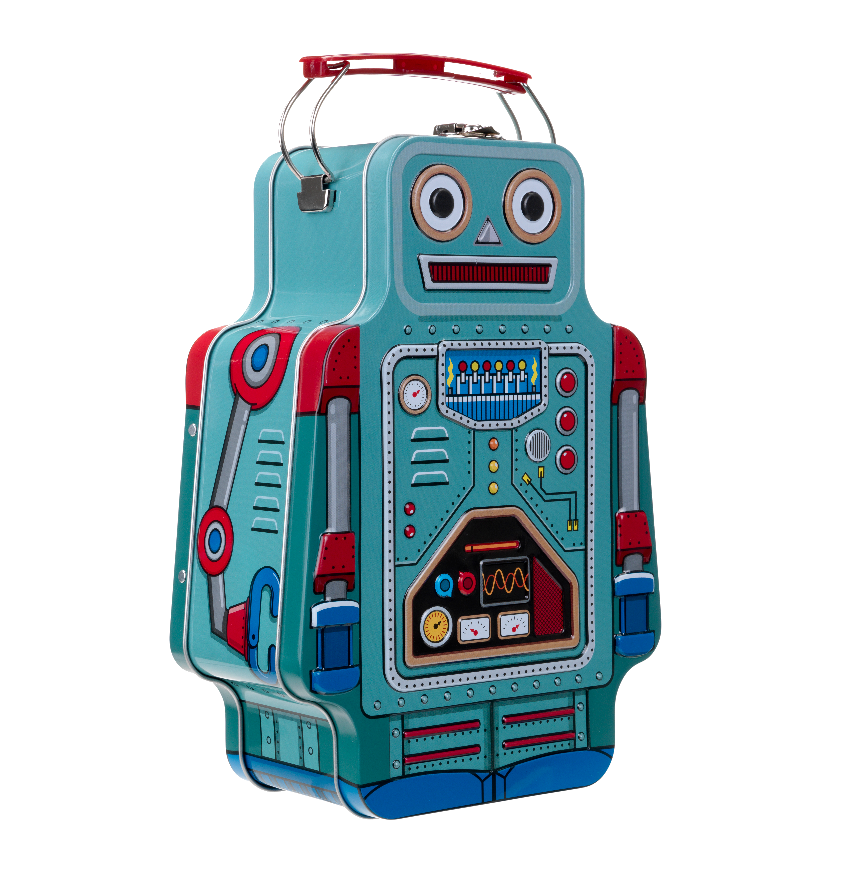

<p align="center"></p>

# lunchbot

[](https://github.com/jesmith0/lunchbot/actions/workflows/ci.yml)

[](https://github.com/astral-sh/ruff)


[](LICENSE)

A chat bot that picks where the team goes for lunch and who drives. Picks are weighted, and the team can vote restaurants up or down or veto a pick.

It runs in **Slack** (see [Slack setup](#slack-setup)), or in your terminal with `uv run lunchbot chat`. It was originally built for HipChat; see [History](#history).

## Commands

Send these with `/lunchbot <command>` in Slack, or just `<command>` in `lunchbot chat`:

| Command | What it does |
| --- | --- |
| `/lunchbot list restaurants` / `/lunchbot list drivers` | Show a list with its weights |
| `/lunchbot add restaurant <name>` / `/lunchbot add driver <name>` | Add an entry with weight 1 |
| `/lunchbot add driver @someone` | Add a driver who gets @-mentioned when it's their turn. Also links an existing driver of the same name. |
| `/lunchbot remove restaurant <name>` / `/lunchbot remove driver <name>` | Remove an entry |
| `/lunchbot upvote <restaurant>` | Raise a restaurant's weight by 1 (max 10) |
| `/lunchbot downvote <restaurant>` | Lower a restaurant's weight by 1 (min 1) |
| `/lunchbot gross` | Vote to veto today's pick. Three votes re-roll it. |

In Slack, the daily pick also has 👍 / 👎 / Gross buttons that do the same as the commands.

## Schedule

`lunchbot post-lunch` posts the day's lunch. Run it on a schedule, for example with cron.

- **Mon / Wed / Fri:** a weighted random restaurant and driver, with buttons to vote or veto. On Fridays it sometimes picks the tech talk instead.
- **Tue:** knowledge lunch. **Thu:** logic puzzle group. Nothing on weekends.

`lunchbot close-voting` closes voting and announces the final pick.

With `LUNCHBOT_PLATFORM=slack`, both post to `LUNCHBOT_SLACK_CHANNEL`. For example, in crontab:

```cron
30 11 * * 1-5  cd /srv/lunchbot && uv run --env-file .env lunchbot post-lunch
30 12 * * 1-5  cd /srv/lunchbot && uv run --env-file .env lunchbot close-voting
```

## Layout

| File | Purpose |
| --- | --- |
| `lunchbot/core.py` | Bot logic: commands, weighted picks, veto voting. Returns messages and never talks to a chat service. |
| `lunchbot/messages.py` | Platform-neutral `Message`: text, mentions, an icon and buttons |
| `lunchbot/storage.py` | Reads and writes the list files |
| `lunchbot/adapters/` | One module per chat platform: `slack.py`, and `console.py` for the terminal |
| `lunchbot/cli.py` | The `lunchbot` command |
| `lunchbot/config.py` | Settings read from environment variables |
| `lunchbot/web.py`, `lunchbot.wsgi` | Flask app and its mod_wsgi entry point |
| `slack/manifest.yml` | Slack app manifest |
| `data/restaurants.txt`, `data/drivers.txt` | Lists in `NAME, WEIGHT` format. Drivers may also have a Slack user ID: `NAME, WEIGHT, slack:U0123ABC`. |
| `data/vetos.txt` | Current veto votes, or `DISABLED` |

## Configuration

All settings come from environment variables. Copy `.env.example` to `.env`, fill it in, and run with `uv run --env-file .env ...`. Never commit `.env`: it holds chat tokens.

| Variable | Purpose |
| --- | --- |
| `LUNCHBOT_DATA_DIR` | Folder holding the list files. Defaults to `data/` in this repo. |
| `LUNCHBOT_PLATFORM` | Where `post-lunch` and `close-voting` post: `console` (default) or `slack` |
| `SLACK_BOT_TOKEN` | Bot token (`xoxb-...`) from **OAuth & Permissions** |
| `LUNCHBOT_SLACK_CHANNEL` | Channel ID for the daily post, e.g. `C0123ABC` |
| `SLACK_APP_TOKEN` | Socket Mode only: app-level token (`xapp-...`) with `connections:write` |
| `SLACK_SIGNING_SECRET` | HTTP mode only: **Signing Secret** from **Basic Information**. Setting it turns on `/slack/events`. |

## Slack setup

1. At [api.slack.com/apps](https://api.slack.com/apps), choose **Create New App → From an app manifest**, pick your workspace, and paste [`slack/manifest.yml`](slack/manifest.yml).
2. **Install to Workspace**, then copy the **Bot User OAuth Token** into `SLACK_BOT_TOKEN`.
3. Under **Basic Information → App-Level Tokens**, generate a token with the `connections:write` scope and put it in `SLACK_APP_TOKEN`.
4. Invite the bot to your lunch channel (`/invite @lunchbot`) and put the channel's ID in `LUNCHBOT_SLACK_CHANNEL`. The ID is at the bottom of the channel's details.
5. Run `uv run --env-file .env lunchbot serve` and try `/lunchbot list restaurants`.
6. Set `LUNCHBOT_PLATFORM=slack` and schedule `post-lunch` and `close-voting` (see [Schedule](#schedule)).

Socket Mode connects out to Slack, so the bot can run anywhere, even behind a firewall. To receive requests over HTTP instead, serve `lunchbot.wsgi` at a public HTTPS URL, set `SLACK_SIGNING_SECRET`, and follow the HTTP notes at the top of the manifest. Requests are checked against the signing secret; unsigned ones are rejected.

## History

lunchbot started in July 2016 as a side project at work. Every day the same two questions came up: where are we eating, and who's driving? [@jesmith0](https://github.com/jesmith0) wrote the first version in a day, and coworkers [@jamesrwaugh](https://github.com/jamesrwaugh) and [@masonjeffers](https://github.com/masonjeffers) helped shape it from there.

It was a humble project, but it was fun, it gave us something to build together, and it solved a problem we all actually had. Over the next few months it picked up:

- **Weighted picks and voting.** Favorite restaurants came up more often, and anyone could vote a restaurant up or down.
- **A remove command and simpler command parsing,** from @jamesrwaugh in the project's first pull requests.
- **The "gross" veto.** Three votes and lunch gets rerolled.
- **A weekly rhythm.** Tuesdays were for "knowledge", Thursdays for the logic puzzle group, and some Fridays the bot sent everyone to the tech talk instead.
- **A request for @mentions** from @masonjeffers ([#3](https://github.com/jesmith0/lunchbot/issues/3)), so the day's driver would have "no excuse not to drive me to lunch".

The bot lived in HipChat, in rooms named *The Force Awakens* and *Rogue One*, until HipChat was shut down in 2019. In 2026 the repo was dusted off: leftover merge conflicts resolved, tests and CI added, and the code moved to modern Python.

## Development

Requires Python 3.12 or newer and [uv](https://docs.astral.sh/uv/).

```sh
uv sync --extra dev        # create .venv from uv.lock
uv run lunchbot chat       # talk to the bot in your terminal
uv run pytest              # tests
uv run ruff check .        # lint
uv run ruff format .       # format
uv run mypy                # type check (strict)
```

To add a chat platform, write an adapter in `lunchbot/adapters/` that sends `Message`s and passes incoming command text to `Bot.handle`. The core shouldn't need to change; a test fails if it imports HTTP or chat libraries.

After changing dependencies in `pyproject.toml`, run `uv lock` and commit `uv.lock`.

On every push and pull request, CI fails if merge conflict markers are present, runs ruff lint and format checks and strict mypy, and runs the tests on Python 3.12, 3.13 and 3.14.

## License

[MIT](LICENSE)
